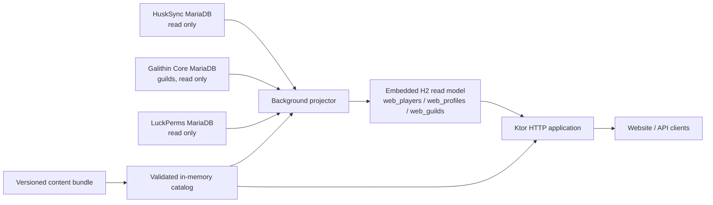
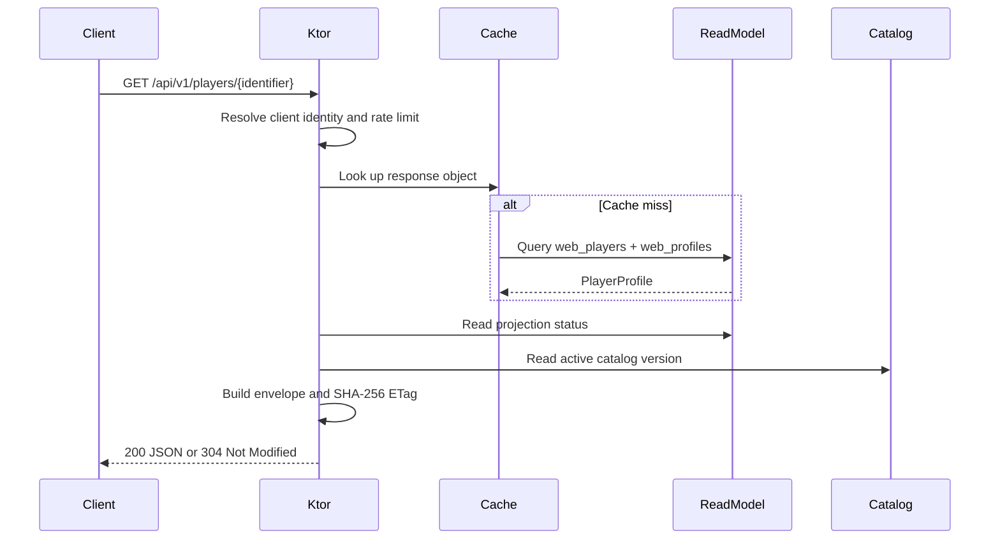

# Architecture

## Design goals

The API is designed around four properties:

1. Web reads must not decode HuskSync blobs.
2. Production plugin databases must be read-only from the API.
3. Presentation content must update independently of the executable JAR.
4. New profile sections and leaderboards should be added behind stable domain models and source adapters.

## System overview

The projector is the only runtime component that reads source plugin databases. HTTP handlers read normalized profile JSON and indexed leaderboard columns from the local embedded database, plus catalog data and assets from the active content bundle.

## Modules

### `domain`

Contains stable public DTOs and ports:

- player profiles and equipment;
- player and dungeon statistics;
- abilities and talents;
- guild/player leaderboard rows and cursor pages;
- catalogs, asset references, and rich text;
- response metadata and problem details;
- repository interfaces.

It has no database, Ktor, or plugin-specific dependencies.

### `sources`

Implements external adapters:

- MariaDB source pools and embedded H2/Hikari/Flyway setup;
- HuskSync snapshot queries;
- Snappy packed JSON and SNBT decoding;
- Galithin item/PDC projection;
- Core guild reads;
- read-only LuckPerms identity/rank resolution;
- normalized read-model persistence and queries;
- content bundle validation and hot reload;
- Adventure/MiniMessage rich-text rendering.

### `application`

Owns the process and HTTP layer:

- YAML/environment configuration;
- runtime dependency wiring;
- Ktor Netty server;
- CORS, compression, logging, JSON, and errors;
- authentication and token-bucket rate limits;
- response caching and ETags;
- health, metrics, OpenAPI, API, and asset routes;
- graceful component shutdown.

The shaded JAR is produced from this module.

### `content-tooling`

Builds the external content bundle from production Core/Nexo sources. It selects only web-visible content, resolves referenced assets, creates catalogs, computes checksums, and atomically replaces the output ZIP.

## Runtime startup

Startup proceeds in this order:

1. Parse configuration and environment substitutions.
2. Create the embedded read-model pool and three read-only MariaDB source pools.
3. Run Flyway migrations against the local H2 read-model file.
4. Load and validate the content bundle.
5. Construct Core, LuckPerms, HuskSync, catalog, decoder, writer, and repository adapters.
6. Start the background projector.
7. Bind the Ktor/Netty HTTP server.

All three configured MariaDB sources must be reachable during initial startup. Once initialized, a source outage does not prevent existing projected profiles from being served, but projection state becomes stale. The local read-model file must remain writable and its filesystem available for HTTP reads and projection writes.

## Runtime shutdown

When the server stops, runtime resources close in this order:

1. cancel projection jobs;
2. stop the catalog watcher and remove extracted temporary content;
3. close the embedded read-model, HuskSync, Core, and LuckPerms connection pools.

Pterodactyl should send the normal termination signal and allow a shutdown grace period.

## Read model

Flyway manages these tables:

| Table | Purpose |
|---|---|
| `web_players` | Identity lookup, level/experience ordering, and eligibility. |
| `web_profiles` | Complete serialized public profile, source version, and freshness. |
| `web_guilds` | Normalized active/disbanded guild rows and leaderboard fields. |
| `web_guild_members` | Active guild membership, roles, fallback names, and contribution totals. |
| `web_projection_state` | HuskSync checkpoint, last success/error, stale state, and catalog version. |

Profiles are stored as JSON because the complete object is normally returned together. Leaderboard sort fields are duplicated into indexed columns so rankings avoid JSON extraction.

### `web_players`

| Column | Purpose |
|---|---|
| `uuid` | Primary key and final player leaderboard tie-breaker. |
| `name`, `normalized_name` | Canonical response name and unique case-insensitive lookup key. |
| `level`, `experience` | Indexed player leaderboard ordering. |
| `eligible` | Player leaderboard inclusion. |

Index: `(eligible, level DESC, experience DESC, uuid)`.

### `web_profiles`

| Column | Purpose |
|---|---|
| `player_uuid` | Primary/foreign key to `web_players`. |
| `profile_json` | Complete serialized `PlayerProfile`. |
| `source_version_uuid` | HuskSync version that produced the row. |
| `source_saved_at` | HuskSync timestamp. |
| `projected_at` | API projection timestamp. |
| `stale` | Last-known-data marker. |

Deleting a `web_players` row cascades to its profile.

### `web_guilds`

| Column | Purpose |
|---|---|
| `id` | Guild UUID primary key and final tie-breaker. |
| `name`, `normalized_name`, `tag`, `normalized_tag` | Public presentation and case-insensitive detail lookup. |
| `level`, `current_experience`, `total_experience` | Progress and leaderboard ordering. |
| `member_limit_bonus`, `claim_limit_bonus`, `claim_count` | Raw Core values combined with bundle-backed level rules at read time. |
| `owner_uuid`, `member_count` | Public ownership/membership summary. |
| `active` | Disbanded-guild exclusion. |
| `projected_at` | Guild refresh timestamp. |

Index: `(active, level DESC, total_experience DESC, id)`.

### `web_guild_members`

| Column | Purpose |
|---|---|
| `guild_id`, `player_uuid` | Composite membership identity. |
| `fallback_name` | LuckPerms name used if no public player profile is projected. |
| `role` | `owner`, `mod`, or `member`. |
| `total_contribution` | Lifetime guild XP contribution. |
| `projected_at` | Guild refresh timestamp. |

### `web_projection_state`

| Column | Purpose |
|---|---|
| `source_name` | Adapter key, currently `husksync-v4`. |
| `checkpoint_timestamp`, `checkpoint_uuid` | Composite incremental cursor. |
| `last_success_at`, `last_error`, `stale` | Operational state. |
| `catalog_version` | Catalog active when state was last written. |

## HTTP read path

## Extension points

Open Graph image requests use a separate read path: the API resolves the projected profile, hashes only UUID/equipment identity and assets, checks persistent storage, and launches a bounded Chromium child process only for a current-version cache miss. Generated PNGs are moved into place atomically. Browser work runs on blocking worker threads and never on Netty's request dispatcher.

The hidden `/stats/{player}/opengraph` render page remains a website concern; the public image endpoint, cache policy, abuse controls, and Chromium lifecycle are API concerns.

### New profile section

1. Add a stable domain DTO/field.
2. Decode it in `ProfileSnapshotDecoder` or a new source adapter.
3. Persist it as part of `PlayerProfile`.
4. update the OpenAPI contract and API documentation.

Existing HTTP repository flow does not need to change if the section belongs to the complete player profile.

### New leaderboard

1. Add indexed normalized fields or a dedicated read-model table.
2. Add deterministic ordering with a unique final tie-breaker.
3. Implement an opaque keyset cursor.
4. add a repository port method and route.
5. add caching, OpenAPI, and tests.

### New source system

Implement a source adapter in `sources`, normalize its data during projection, and keep its SDK/blob format out of the HTTP layer.

### New catalog kind

Add a `CatalogKind`, generator output, domain fields if required, and `/api/v1/catalog/{kind}` OpenAPI enum entry. Content updates should continue to happen through bundle replacement rather than JAR rebuilds.

## Intentional boundaries

- There is no Core identity migration or API-owned table inside Core.
- LuckPerms presentation is reconstructed read-only from SQL.
- Authentication changes rate limits but exposes no private profile fields.
- Player exclusions remove leaderboard rows but do not make profiles private.
- The API does not pre-render item thumbnails; the website receives models and textures.
- The v1 model is English-only.

## Current operational limitations

- In-memory caches and rate limits are process-local; replicas do not coordinate them.
- Open Graph cache directories must be shared if multiple API replicas are expected to reuse the same generated images.
- Only the active catalog version's assets are served.
- After a hot content swap, stored profile asset references converge on the next player snapshot or full reconciliation. Clients should prefer the current catalog entry when an embedded asset version differs from response metadata.
- Joined times are derived from HuskSync snapshot history, not authoritative Core session history.
- Ban state is not sourced; configured exclusions are the supported leaderboard control.
- LuckPerms SQL reconstruction does not include transient nodes or every live contextual calculation.
